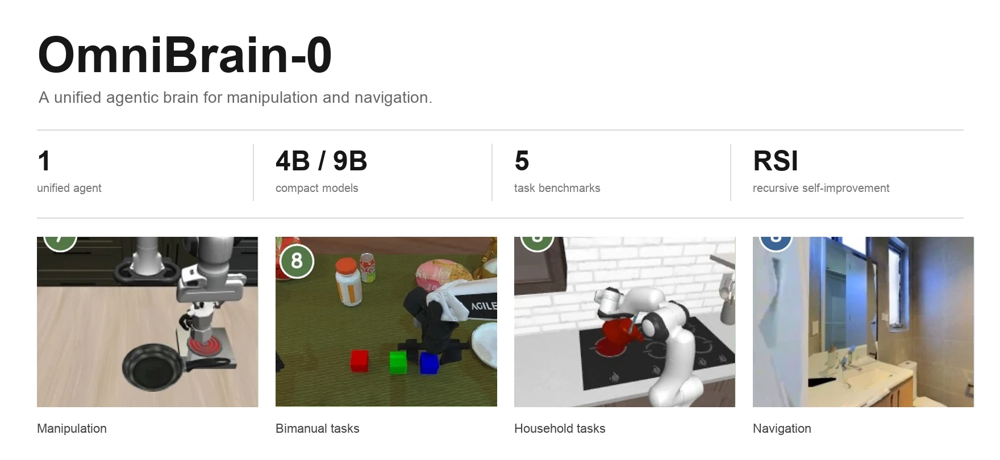
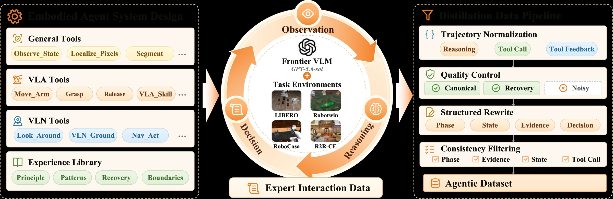
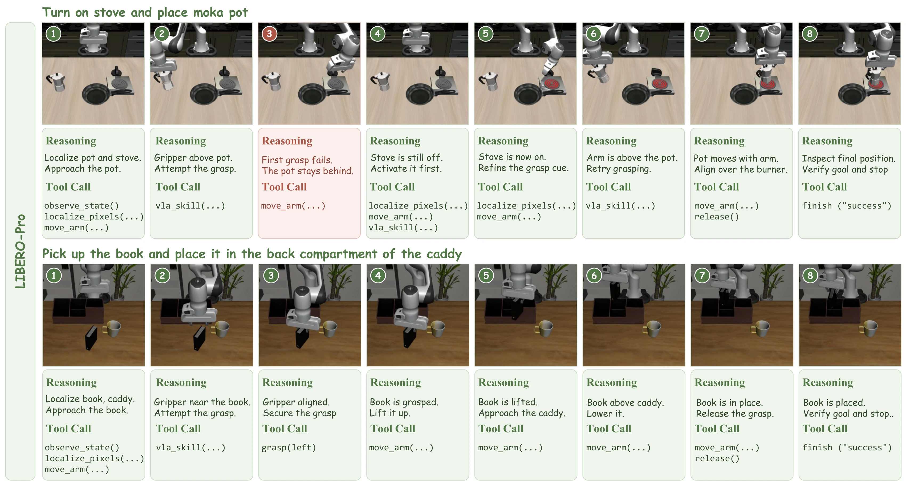
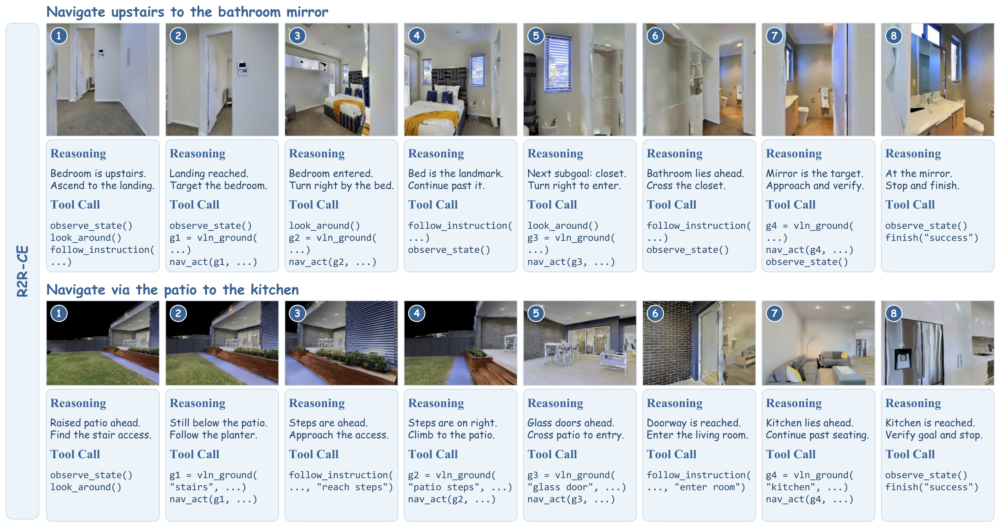
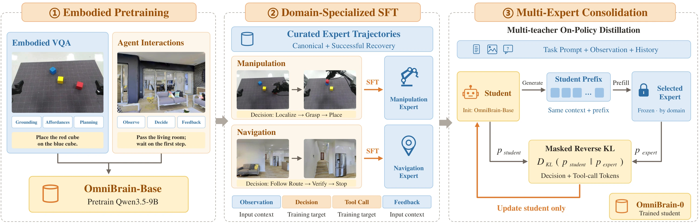
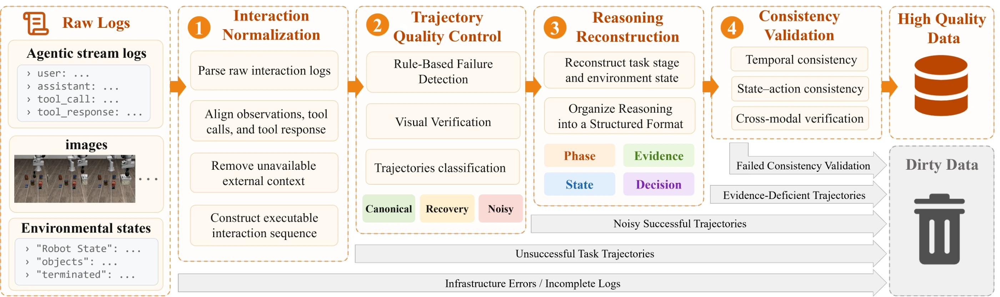
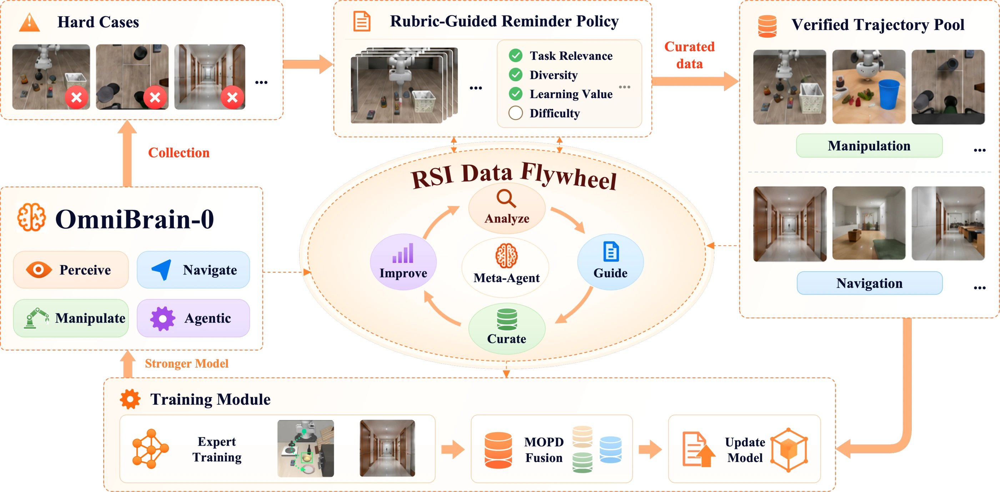
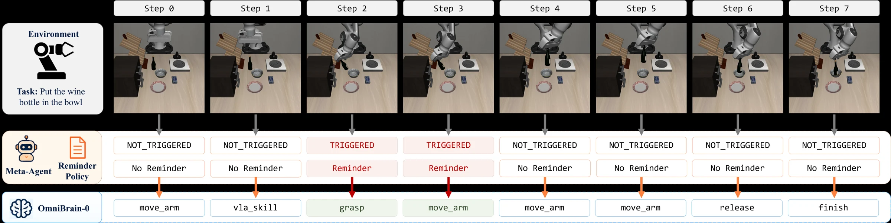
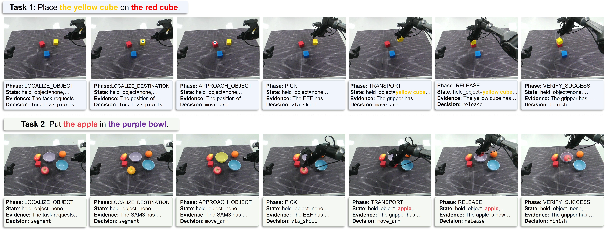

<h1 align="center">OmniBrain-0</h1>
<h3 align="center">A Unified Agentic Model for Embodied Intelligence</h3>

<p align="center">
  Xiaomi Embodied Intelligence Team &nbsp;×&nbsp; Tsinghua University &nbsp;×&nbsp; University of Macau
</p>

<p align="center">
  <a href="https://luo-yc17.github.io/OmniBrain-0/">Project Page</a> &nbsp;·&nbsp;
  <a href="#overview">Overview</a> &nbsp;·&nbsp;
  <a href="#results">Results</a> &nbsp;·&nbsp;
  <a href="#method">Method</a> &nbsp;·&nbsp;
  <a href="#recursive-self-improvement">RSI</a> &nbsp;·&nbsp;
  <a href="#citation">Citation</a>
</p>

<p align="center">
  
</p>

## Overview

**OmniBrain-0 is a compact agentic brain that unifies manipulation and navigation in one learned high-level decision model.** It understands instructions, plans over multiple steps, coordinates specialist tools, tracks execution progress, and recovers from failures using environmental feedback.

The unified model learns task-level decisions while perception modules, VLA/VLN policies, and motion controllers retain their specialized execution capabilities.

- **One shared agent:** manipulation and navigation use the same high-level decision model.
- **4B / 9B models:** compact planners learn skill orchestration and feedback-driven recovery.
- **Five task benchmarks:** LIBERO-Pro, LIBERO-Plus, RoboCasa365, RoboTwin 2.0, and R2R-CE.
- **Recursive self-improvement:** rubric-guided reminders and verified trajectories connect interaction evidence to continued learning.

## Agent Architecture

<p align="center">
  
</p>

The shared high-level model selects semantic tool invocations. Each execution returns observations and feedback for the next decision; expert interactions from the same framework supply trajectories for learning.

## Results

Task success rates (%) reported in the manuscript. The RSI column denotes the model iterated through the RSI Data Flywheel.

| Benchmark | 4B | 9B | RSI iteration |
|:--|--:|--:|--:|
| LIBERO-Pro | 62.4 | 65.5 | **69.3** |
| LIBERO-Plus | 82.3 | 83.8 | **84.5** |
| RoboCasa365 | 33.6 | 39.6 | **43.2** |
| RoboTwin 2.0 | 87.2 | 88.2 | **89.4** |
| R2R-CE | 55.0 | 65.0 | **66.0** |

The first four rows report Overall / Total success. R2R-CE reports SR on the 100-episode `rand100` subset of Val-Unseen. These task evaluations are complemented by EmbSpatial-Bench, RefSpatial-Bench, and real-world manipulation tasks.

## Task Execution

### Manipulation with recovery

<p align="center">
  
</p>

The initial moka-pot grasp fails. OmniBrain-0 inspects the execution outcome, changes the action order, activates the stove, refines the grasp target, and retries before placing the pot on the burner.

### Navigation through ordered landmarks

<p align="center">
  
</p>

The navigation examples show instruction decomposition, grounded sub-goals, progress tracking, and endpoint verification through successive observations and tool calls.

## Method

OmniBrain-0 learns embodied capabilities through three stages:

1. **Embodied pretraining** establishes a shared initialization from embodied question answering and interaction data.
2. **Domain-specialized distillation** transfers expert planning and recovery behavior into manipulation and navigation agents.
3. **Multi-teacher on-policy distillation (MOPD)** consolidates the domain experts into a unified student using supervision on student-generated decision prefixes.

<p align="center">
  
</p>

### Interaction Data Construction

Expert interactions are normalized, checked for trajectory quality, rewritten into state-grounded reasoning, and validated for consistency. Training retains canonical successes and successful recoveries.

<p align="center">
  
</p>

## Recursive Self-Improvement

**Analyze → Guide → Curate → Improve.** A Meta-Agent analyzes interaction evidence and refines rubrics and step-level reminders. Verified trajectories augment domain-expert training; MOPD then consolidates the updated experts into the next unified model.

<p align="center">
  
</p>

### Reminder-Guided Execution

<p align="center">
  
</p>

In this wine-bottle placement example, reminders are triggered before the grasp at step 2 and the following arm motion at step 3. The other displayed decisions proceed without reminders.

## Real-World Execution

Real-world evaluation includes block stacking, apple placement, and drawer opening. The examples below show the robot coordinating perception and manipulation tools while updating its decisions from execution feedback.

<p align="center">
  
</p>

## Project Website

Visit the project page at **https://luo-yc17.github.io/OmniBrain-0/**.

This repository contains the research project page and its source. The page includes interactive execution keyframes, benchmark results, the training framework, and RSI visualizations.

For local preview and GitHub Pages deployment, see [WEBSITE.md](WEBSITE.md).

## Citation

```bibtex
@techreport{omnibrain0_2026,
  title = {OmniBrain-0: A Unified Agentic Model for Embodied Intelligence},
  author = {{Xiaomi Embodied Intelligence Team}
            and {Tsinghua University}
            and {University of Macau}},
  year = {2026}
}
```
